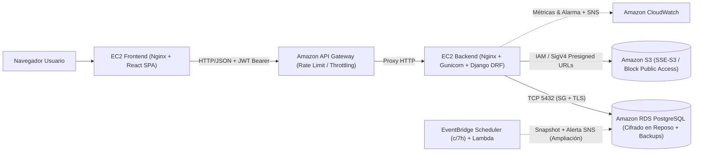

# 🎂 Dulce Arte — API RESTful & Arquitectura Distribuida AWS (Evaluación N.º 4)

**Asignatura:** Programación Backend — Evaluación N.º 4 (30%)  
**Base reutilizada:** Proyecto Evaluación N.º 3 (*Pastelería Artesanal "Dulce Arte"*) adaptado a arquitectura distribuida AWS y controles de seguridad.  
**Stack:** Django 6 · Django REST Framework · SimpleJWT · Argon2 · React + Vite + Tailwind · Amazon API Gateway · EC2 (Frontend + Backend) · RDS PostgreSQL · S3 · CloudWatch · SonarQube · OWASP ZAP.

---

## 🏗️ Arquitectura Distribuida (EVA 4)



---

## 📂 Estructura del Repositorio

```text
Eva3 Backend/
├── dulce_arte_project/               # Configuración Django (JWT, CORS, Argon2, RDS TLS, S3, OpenAPI)
├── gestion_pasteleria/               # 12 modelos relacionales, RBAC API, serializers, tests y comandos
│   ├── permissions.py                # Autorización RBAC por rol en endpoints DRF
│   ├── api_views.py                  # ViewSets CRUD + /auth/token/, /auth/me/, /health/, /dashboard/resumen/
│   ├── api_urls.py                   # Rutas /api/v1/ + Swagger UI (/api/v1/docs/)
│   ├── tests.py                      # 12 pruebas automatizadas (lógica BOM + JWT + RBAC + CRUD + Argon2)
│   └── management/commands/
│       ├── seed_dulce_arte.py        # Datos de demostración y usuarios por rol
│       └── verificar_seguridad.py    # Evidencia verificable de Argon2, RDS y S3
├── frontend/                         # Frontend desacoplado React + Vite + Tailwind (para EC2 Frontend)
│   ├── src/services/api.js           # Cliente HTTP/JSON con manejo automático de JWT + Refresh Token
│   └── src/components/               # Dashboard, Clientes CRUD, Pedidos/BOM, Kanban, Bodega, Despacho, Rate Limit
├── deploy/
│   ├── deploy_backend_ec2.sh         # Despliegue EC2 Backend conectado a RDS + S3
│   ├── deploy_frontend_ec2.sh        # Despliegue EC2 Frontend apuntando a API Gateway
│   └── lambda_rds_backup_7h.py       # Referencia Lambda + EventBridge para respaldo RDS cada 7 horas
├── docs/
│   ├── GUIA_DESPLIEGUE_AWS_EVA4.md   # Paso a paso AWS Academy (RDS, S3, API GW, CloudWatch, SAST/DAST)
│   └── BANCO_PREGUNTAS_ORALES_EVA4.md# Guía de defensa oral (Bloques A, B, C y D)
├── sonar-project.properties          # Configuración SAST SonarQube
├── prompts_ia.md                     # Recomendaciones de IA contrastadas con documentación oficial
└── requirements.txt
```

---

## 🔑 Endpoints Principales de la API (`/api/v1/`)

| Método | Endpoint | Auth / Rol | Descripción |
| :--- | :--- | :--- | :--- |
| `GET` | `/api/v1/health/` | Público | Verifica estado API, conexión PostgreSQL/RDS (`SELECT 1`) y S3 (ideal para probar **Rate Limit** en API Gateway) |
| `POST` | `/api/v1/auth/token/` | Público | Login JWT: devuelve `access`, `refresh` y datos del usuario/rol |
| `POST` | `/api/v1/auth/token/refresh/` | Público | Renueva el token JWT `access` |
| `GET` | `/api/v1/auth/me/` | JWT | Identidad actual, rol RBAC y algoritmo hasher (`argon2`) |
| `GET` | `/api/v1/dashboard/resumen/` | JWT | KPIs y estado de infraestructura para el Dashboard SPA |
| `GET/POST/PATCH/DELETE` | `/api/v1/clientes/` | JWT (`VENTAS` / `ADMIN`) | CRUD completo de clientes con validación de RUT y protección `409` |
| `GET/POST/PATCH/DELETE` | `/api/v1/pedidos/` | JWT (`VENTAS` / `ADMIN`) | CRUD de pedidos + `simular_cotizacion`, `explosion_bom`, `mover_kanban` (`COCINA`) |
| `GET/POST/PATCH/DELETE` | `/api/v1/insumos/` | JWT (`BODEGA` / `ADMIN`) | CRUD de insumos + `alertas_criticas`, `ajustar_stock` |
| `GET/POST/PATCH/DELETE` | `/api/v1/rutas-despacho/` y `/api/v1/despachos/` | JWT (`REPARTIDOR` / `ADMIN`) | Rutas y confirmación con firma digital (`confirmar_entrega`) |
| `GET` | `/api/v1/docs/` | Sesión / Público | Documentación interactiva OpenAPI / Swagger UI |

### Credenciales de prueba (`seed_dulce_arte`)
Contraseña común: **`dulcearte2026`** (almacenada con **Argon2id + salt automático**):
* `admin` (`ADMIN`) · `ventas_camila` (`VENTAS`) · `chef_matias` (`COCINA`) · `bodega_pedro` (`BODEGA`) · `repartidor_lucas` (`REPARTIDOR`)

---

## 🚀 Ejecución Local (Backend + Frontend Separados)

### 1. Backend DRF (Puerto `8000`)
```powershell
.\venv\Scripts\activate
pip install -r requirements.txt
python manage.py migrate
python manage.py seed_dulce_arte
python manage.py test -v 2
python manage.py verificar_seguridad
python manage.py runserver 127.0.0.1:8000
```

### 2. Frontend React SPA (Puerto `5173`)
```powershell
cd frontend
npm install
npm run dev
```
Abrir `http://localhost:5173/` e iniciar sesión con JWT.

---

## ☁️ Despliegue en AWS y Defensa Oral
* Revisa el paso a paso completo de AWS, SonarQube y OWASP ZAP en [docs/GUIA_DESPLIEGUE_AWS_EVA4.md](docs/GUIA_DESPLIEGUE_AWS_EVA4.md).
* Revisa las respuestas preparadas para la evaluación oral en [docs/BANCO_PREGUNTAS_ORALES_EVA4.md](docs/BANCO_PREGUNTAS_ORALES_EVA4.md).
